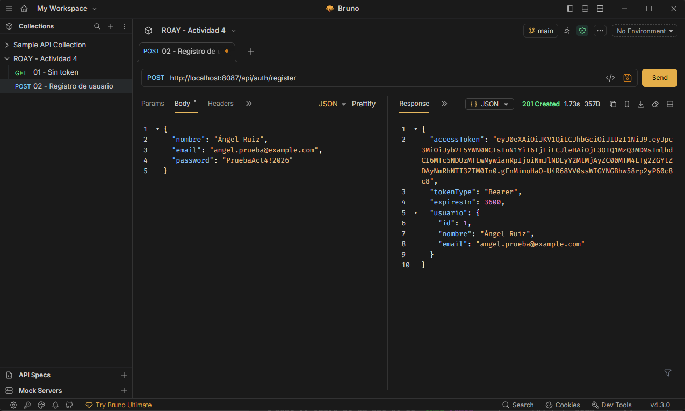
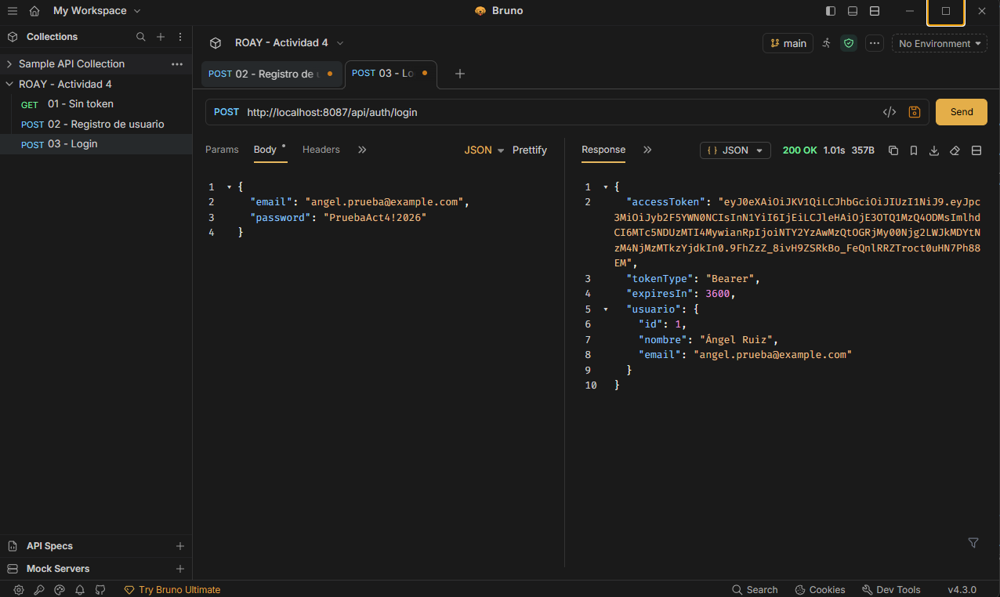
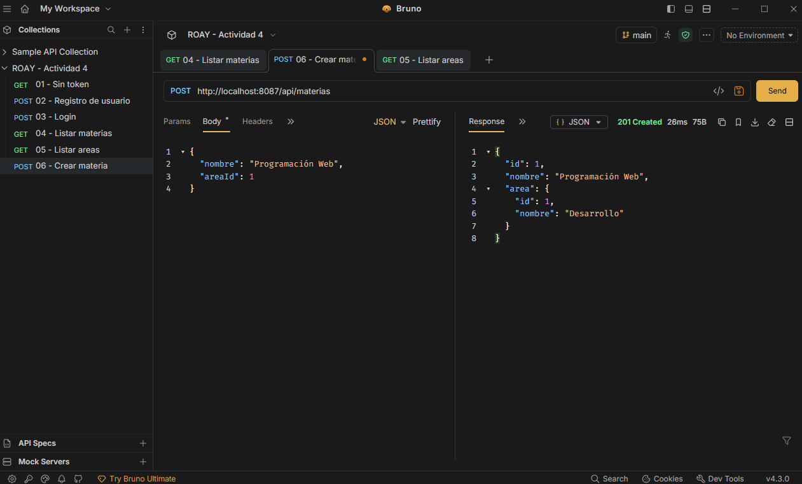
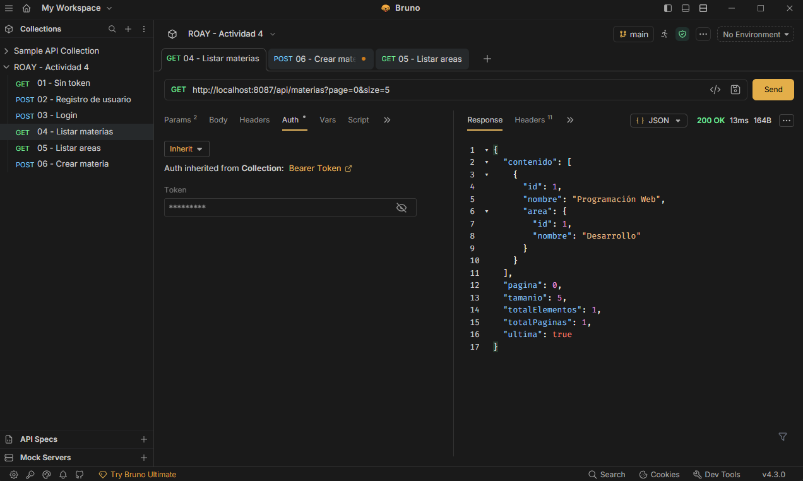
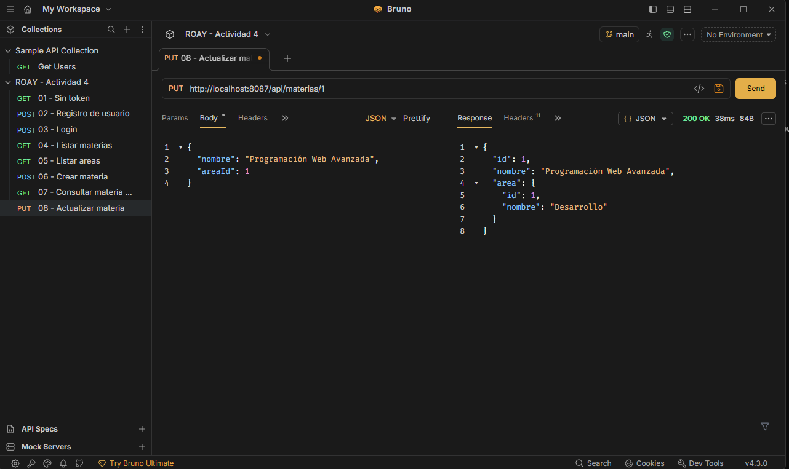
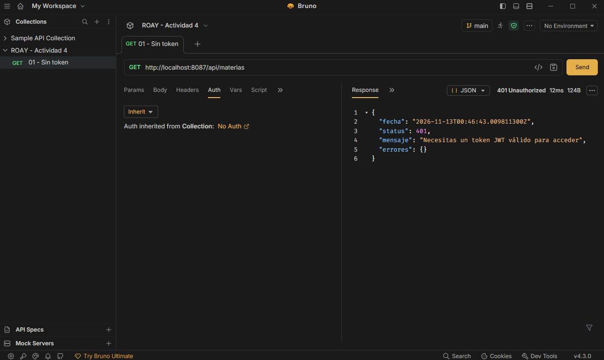
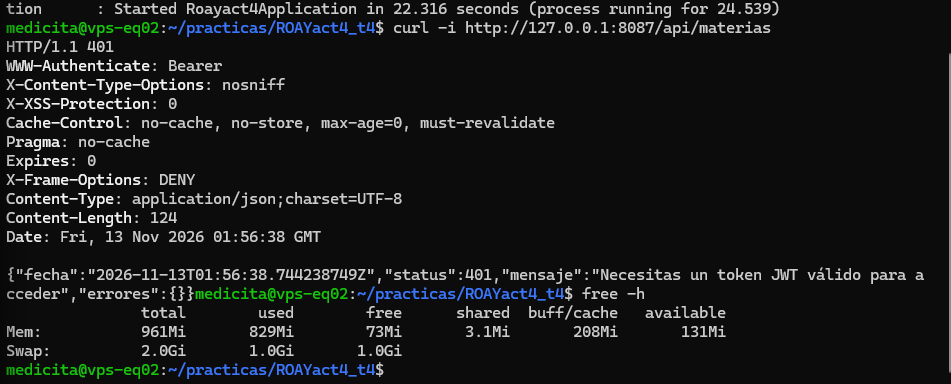

# Actividad 4 — API REST de materias con JWT

**Alumno:** Ángel Yibán Ruiz Osante  
**Materia:** Programación Web

## Enlaces

- Repositorio: https://github.com/AngelOxe/ROAYact4_t4
- URL base de la API: http://138.68.234.30:8087
- Endpoint protegido: http://138.68.234.30:8087/api/materias

Al abrir un endpoint protegido sin token, la API responde `401 Unauthorized`. Es el comportamiento esperado.

## Descripción

API REST para crear, consultar, actualizar y eliminar materias almacenadas en MySQL. Cada materia pertenece a un área.

La aplicación responde en JSON y utiliza DTOs, validaciones, paginación y autenticación con Spring Security y JWT. No utiliza vistas Thymeleaf.

## Tecnologías

- Java 21 y Spring Boot 4.1.2.
- Spring Web MVC y Spring Data JPA.
- MySQL.
- Spring Security y OAuth2 Resource Server.
- Bean Validation.
- Maven.
- Bruno para probar y guardar las peticiones.

## Organización del proyecto

| Paquete | Responsabilidad |
|---|---|
| `entity` | Entidades Area, Materia y Usuario. |
| `repository` | Acceso a MySQL mediante JpaRepository. |
| `dto` | Datos de entrada y salida de la API. |
| `service` | Lógica de negocio, autenticación y generación de tokens. |
| `controller` | Rutas HTTP y respuestas JSON. |
| `config` | Configuración de seguridad, JWT y PasswordEncoder. |
| `exception` | Manejo centralizado de errores. |

La colección de peticiones está en `bruno` y las evidencias están en `capturas`.

## Entidades y relación

- **Area:** identificador y nombre.
- **Materia:** identificador, nombre y área.
- **Usuario:** identificador, nombre, correo único y hash de contraseña.

Materia utiliza `@ManyToOne` y `@JoinColumn(name = "area_id")`. La llave foránea `materias.area_id` referencia `areas.id`.

Las respuestas de materias incluyen el nombre del área mediante un DTO. Las respuestas de usuarios no incluyen la contraseña ni su hash.

## Autenticación

El registro guarda la contraseña como un hash PBKDF2. El login compara la contraseña recibida contra ese hash mediante PasswordEncoder.

Cuando la autenticación es correcta, la API entrega un JWT firmado con HS256 y una duración configurada de 3600 segundos.

El token incluye:

- `iss`: emisor.
- `sub`: ID del usuario.
- `iat`: fecha de emisión.
- `exp`: fecha de vencimiento.
- `jti`: identificador del token.

Las peticiones protegidas deben enviar:

```http
Authorization: Bearer TOKEN
```

Spring Security valida el token y aplica las reglas de acceso. La API es stateless: cada petición protegida debe presentar su token.

El JWT está firmado, no cifrado; no contiene contraseñas.

## Endpoints

| Método | Ruta | Función | Autenticación |
|---|---|---|---|
| POST | `/api/auth/register` | Registrar usuario y entregar token. | Pública |
| POST | `/api/auth/login` | Autenticar usuario y entregar token. | Pública |
| GET | `/api/areas` | Consultar áreas disponibles. | JWT |
| GET | `/api/materias?page=0&size=5` | Listar materias con paginación. | JWT |
| GET | `/api/materias/{id}` | Consultar una materia. | JWT |
| POST | `/api/materias` | Crear una materia. | JWT |
| PUT | `/api/materias/{id}` | Actualizar una materia. | JWT |
| DELETE | `/api/materias/{id}` | Eliminar una materia. | JWT |

La primera página es `0`. El tamaño permitido es de 1 a 100 registros.

## Validaciones y códigos HTTP

Los DTOs utilizan `@Valid` y restricciones como `@NotBlank`, `@Email`, `@Size`, `@NotNull` y `@Positive`.

| Código | Uso |
|---|---|
| 200 | Consulta, login, actualización o eliminación correctos. |
| 201 | Registro de usuario o creación de materia correctos. |
| 400 | Datos o parámetros inválidos. |
| 401 | Credenciales incorrectas o token ausente, inválido o vencido. |
| 404 | Recurso inexistente. |
| 409 | Conflicto, como un correo ya registrado. |

Los errores se devuelven en JSON con fecha, estado, mensaje y detalles cuando corresponda.

## Ejecución local

Se requiere Java 21, MySQL y una base llamada `roayact4_t4`. El usuario de MySQL debe tener permisos sobre esa base.

Desde PowerShell, en la carpeta que contiene `pom.xml`:

```powershell
$env:SPRING_DATASOURCE_URL = "jdbc:mysql://localhost:3306/roayact4_t4"
$env:SPRING_DATASOURCE_USERNAME = "roay_act4"
$env:SERVER_PORT = "8087"
```

Ejecutar esta línea por separado e introducir la contraseña cuando se solicite:

```powershell
$claveBD = Read-Host "Contraseña MySQL" -AsSecureString
```

Después:

```powershell
$credencialBD = [System.Management.Automation.PSCredential]::new("roay_act4", $claveBD)
$env:SPRING_DATASOURCE_PASSWORD = $credencialBD.GetNetworkCredential().Password
$env:DB_PASSWORD = $env:SPRING_DATASOURCE_PASSWORD
```

Generar una clave JWT local si todavía no existe:

```powershell
if (-not (Test-Path .env.jwt)) {
    $bytesJwt = New-Object byte[] 32
    $generadorJwt = [System.Security.Cryptography.RandomNumberGenerator]::Create()
    $generadorJwt.GetBytes($bytesJwt)
    $generadorJwt.Dispose()

    [Convert]::ToBase64String($bytesJwt) |
        Set-Content -Path .env.jwt -Encoding ascii
}
```

Cargar la clave y arrancar:

```powershell
$env:JWT_SECRET = (Get-Content .env.jwt -Raw).Trim()
.\mvnw.cmd spring-boot:run
```

La aplicación local queda disponible en `http://localhost:8087`.

Las variables deben cargarse nuevamente al abrir otra terminal. `.env.jwt` está excluido de Git y no debe publicarse.

Para ejecutar las pruebas de Maven y generar el JAR, con MySQL disponible y las variables cargadas:

```powershell
.\mvnw.cmd clean package
```

El JAR se genera en `target/roayact4-0.0.1-SNAPSHOT.jar`.

## Preparación de las áreas

Después del primer arranque, JPA genera las tablas con la configuración `ddl-auto=update`.

Antes de crear una materia, consultar el catálogo:

```sql
SELECT id, nombre FROM areas;
```

Si está vacío, agregar un área:

```sql
INSERT INTO areas (nombre) VALUES ('Desarrollo');
```

Usar el ID real del área en el campo `areaId` de las peticiones.

## Pruebas con Bruno

Abrir la carpeta `bruno` como colección.

1. Ejecutar una petición protegida sin token: debe responder 401.
2. Registrar un usuario de prueba.
3. Ejecutar login.
4. Utilizar `{{token}}` en Auth → Bearer Token para las peticiones protegidas.
5. Consultar áreas y crear una materia con un `areaId` existente.
6. Consultar el listado paginado y el registro individual.
7. Actualizar y eliminar la materia.
8. Consultar el registro eliminado: debe responder 404.
9. Probar datos inválidos, contraseña incorrecta y token inválido.

El script Post Response del login carga el token en una variable temporal:

```javascript
bru.setVar("token", "");

if (res.getStatus() === 200) {
    const respuesta = res.getBody();
    bru.setVar("token", respuesta.accessToken);
}
```

Al cerrar Bruno o vencer el token, ejecutar nuevamente el login.

Para pruebas locales se utiliza `http://localhost:8087`; para el VPS, `http://138.68.234.30:8087`. Cada servidor tiene sus propios usuarios, datos y clave JWT.

## Evidencias

### Registro



### Login



### Crear



### Leer con paginación y relación



### Actualizar



### Eliminar


### Rechazo sin token



### Aplicación iniciada en el VPS



## Despliegue

- Carpeta: `/home/medicita/practicas/ROAYact4_t4`.
- Archivo ejecutable: `app.jar`.
- Puerto: `8087`.
- Base de datos: `roayact4_t4`, alojada en el VPS.
- Credenciales y clave JWT suministradas mediante variables de entorno.

El proceso se inició con `nohup` y un heap máximo de 128 MiB. Los mensajes se guardan en `app.log`. Este mecanismo no configura el arranque automático después de reiniciar el VPS.

Las actividades anteriores utilizan puertos independientes: 8081, 8083 y 8085.

### Verificación final del VPS

Marcar después de ejecutar las comprobaciones:

- [ ] Acceso externo sin token devuelve 401.
- [ ] Registro y login funcionan en el VPS.
- [ ] Crear, listar, consultar por ID, actualizar y eliminar funcionan con token del VPS.
- [ ] Las actividades 1, 2 y 3 siguen accesibles.

## Alcance de seguridad

El despliegue académico utiliza HTTP. Para uso real debe configurarse HTTPS para proteger contraseñas y tokens durante su transmisión.

Se utilizan datos ficticios de prueba. Las credenciales reales de MySQL y la clave de firma JWT no se incluyen en el repositorio.

## Documentación consultada

- Spring Security: https://docs.spring.io/spring-security/reference/
- Almacenamiento de contraseñas: https://docs.spring.io/spring-security/reference/features/authentication/password-storage.html
- Bruno: https://docs.usebruno.com/